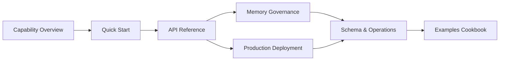
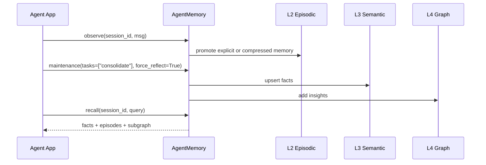

# memx Documentation Index

`memx` is a long-term memory system for agents. The docs follow the path "understand the
capabilities first, then integrate through the APIs, and finally govern and deploy". The
project currently uses a single internal scope `human_mem_project`, so business integrations
do not need to maintain scope information.

## Reading Path

## Documentation Catalog

| Doc | Audience | Focus |
| --- | --- | --- |
| [Complete Usage Guide](usage.md) | First-time integrators, app developers, SRE | Installation, embedding choices, SDK, CLI, HTTP service, and verification |
| [Architecture Docs](architecture/README.md) | Architects, developers, SRE | Full architecture diagrams, classification, data structures, consolidation, retrieval, decisions, and roadmap |
| [Architecture HTML Slider](architecture-slider.html) | Reviewers, sharing, project sync | Self-contained detailed architecture demo with desktop, mobile, and print support |
| [Architecture Verification Matrix](architecture/verification.md) | Reviewers, testers, release engineers | Evidence tracing from architecture claims to pytest, evals, and release gates |
| [Agent Memory End-to-End Flow](agent-memory-flow.md) | Architects, platform engineers | L0–L4 layers, write pipeline, read pipeline, evolution pipeline |
| [Capability Matrix](capability-matrix.md) | Product, architects, integrators | Capability boundaries, API mapping, and typical usage scenarios |
| [API Reference](api-reference.md) | SDK integrators, backend engineers | `AgentMemory` methods, parameters, return structures, error boundaries |
| [CLI Guide](cli.md) | Local debugging, SRE, test engineers | Command entrypoints, module call chains, parameters, feature verification |
| [Examples Cookbook](examples-cookbook.md) | App developers, test engineers | Preference memory, context assembly, fact changes, deletion, and diagnostics examples |
| [Memory Governance](memory-governance.md) | Platform engineers, data governance | Conflict handling, dynamic forgetting, graph auditing, evidence cascading |
| [Configuration Reference](configuration-reference.md) | Backend engineers, SRE | `MemoryConfig` parameters, tuning advice, production recommendations |
| [Production Deployment](production-deployment.md) | SRE, backend engineers | Port/Adapter, Redis, PostgreSQL/pgvector, Neo4j, LLM Gateway |
| [Storage & Schema](storage-schema.md) | Data platform, DBA | L0–L4 reference DDL, indexes, data lifecycle |
| [Evaluation System](evals.md) | Algorithm, test, and release engineers | Datasets, metrics, thresholds, reports, and the extension roadmap |

## Core Concepts

- **L0 Raw Observations**: Stores short-term conversation messages; handles raw input ingestion and compression triggers.
- **L1 Working Memory**: Stores rolling summaries, unresolved slots, and session entities.
- **L2 Episodic Memory**: Stores retrievable episodes with dense/sparse hybrid recall, reinforcement, updates, and forgetting.
- **L3 Semantic Facts**: Stores structured facts, version chains, evidence fingerprints, and conflict logs.
- **L4 Cognitive Graph**: Stores entities, relationships, and insights, with graph context and audit repair.
- **Port/Adapter**: The service layer depends only on Port contracts; the local default is the in-memory Adapter, replaceable with external stores in production.
- **Scheduler Task Management**: `src/mem/scheduler/manager.py` handles stateful scheduling and only registers `consolidate` and `forget` tasks.

## Minimal Integration Loop

## Recommended Integration Order

1. Run `observe -> reflect -> recall` locally with `MemoryConfig(backend_mode="memory")`.
2. Choose the `local` or `gateway` embedding per environment and verify the vector dimensions.
3. Decide whether to persist synchronously based on business SLA; for production critical paths, `persist_on_write=False` is recommended.
4. Configure the production Adapter dependencies and use `backend_diagnostics()` for a pre-start health check.
5. Call `maintenance(tasks=["consolidate", "forget"])` periodically and observe scheduler tasks and embedding status via `/health`.
